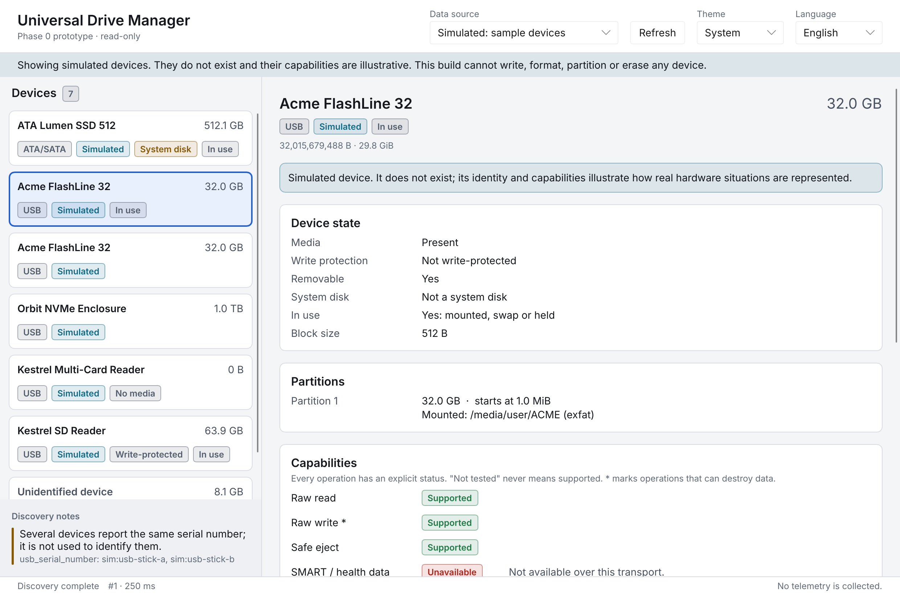

# Universal Drive Manager

A free and open-source, cross-platform desktop application for managing USB
and external storage, written in Rust with a Slint GUI.

> **Status: Phase 0 — architecture validation, read-only prototype.**
> This build cannot write, format, partition, erase, clone or restore any
> device. It lists devices (simulated, or read-only on Linux) and shows their
> state, identity evidence and capabilities.



## Build and run

Requirements: Rust 1.92+ (stable). On Debian/Ubuntu:
`libfontconfig1-dev libxkbcommon-dev` to build, `libxkbcommon-x11-0` to run
under X11.

```sh
cargo run -p udm-gui            # run as a regular user; the app refuses to run as root
UDM_LANG=ko cargo run -p udm-gui   # Korean UI
UDM_LOG=debug cargo run -p udm-gui # verbose logs on stderr
```

Read-only discovery from the command line (serials redacted by default):

```sh
cargo run -p udm-platform --example discover
```

## Checks

```sh
cargo fmt --all --check
cargo clippy --workspace --all-targets -- -D warnings
cargo test --workspace
```

## Documentation

- [Architecture](docs/ARCHITECTURE.md) and [decision records](docs/ADR/README.md)
- [Threat model](docs/THREAT_MODEL.md)
- [Platform support and constraints](docs/PLATFORM_SUPPORT.md)
- [Testing strategy](docs/TESTING_STRATEGY.md)
- [UX design system](docs/UX_DESIGN_SYSTEM.md)
- [Phase 0 test report](docs/PHASE0_TEST_REPORT.md)
- Project rules for contributors and AI assistants: [CLAUDE.md](CLAUDE.md)

## License

Not chosen yet — see [ADR-0002](docs/ADR/0002-gui-toolkit-slint.md) for the
options and their implications with Slint's licensing.
