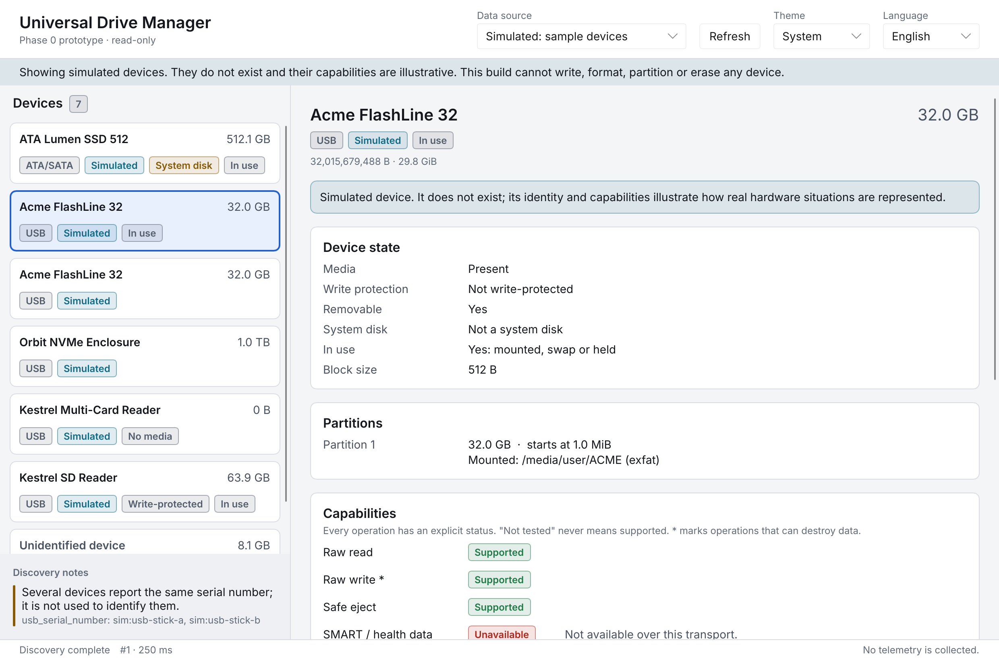
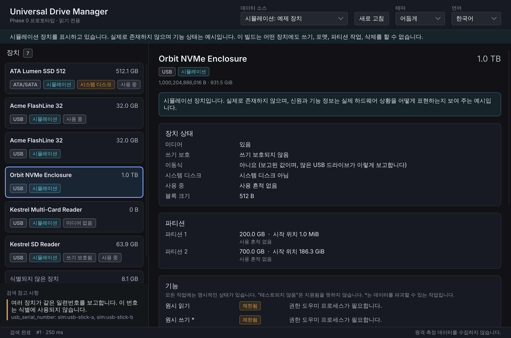

# UX Design System — "Precision Minimalism"

Status: Phase 0 draft (2026-11-04). Tokens live in
`crates/udm-gui/ui/theme.slint`; screens must not hard-code colors, sizes or
spacing.

## 1. Principles

1. **Dashboard first**: the device list and the selected device's state are
   the home screen.
2. **Distinct status channels**: device *state* (badges, "Device state"
   card), *capabilities* (four-state table with reasons) and *operation
   status* (future job panel) never share a widget.
3. **Text first, color second**: every status is written out; color only
   reinforces it.
4. **Unknown is shown as unknown**: "Not reported", "Unknown (treated as
   system disk)", "Size unknown", "Unidentified device" — never a guessed
   value.
5. **Destructive actions are visually separate**: the `destructive` token is
   reserved for them. Phase 0 has none; capability names of destructive
   operations are marked with `*`.
6. **No decorative animation**; nothing delays feedback.

## 2. Tokens

### Color (light / dark)

| Token | Light | Dark | Use |
|-------|-------|------|-----|
| canvas | `#f4f5f7` | `#0f1115` | window background |
| surface | `#ffffff` | `#171a20` | cards, header |
| surface-sunken | `#eef0f3` | `#13161b` | notes area |
| surface-hover / -selected | `#f0f2f5` / `#e8f0fe` | `#1d2128` / `#1b2433` | list items |
| border / border-strong | `#d9dde3` / `#b9c0ca` | `#2b313b` / `#3a414d` | 1 px strokes |
| text-primary / -secondary / -tertiary | `#14171c` / `#4a5260` / `#626b78` | `#e8ebf0` / `#b4bcc8` / `#8f99a8` | text |
| accent (= focus-ring) | `#1f5fd1` | `#7aa7ff` | selection, focus |
| tone-positive | `#1e7a46` | `#4cc38a` | Supported, high confidence |
| tone-caution | `#8a5a00` | `#e0a33a` | Limited, system disk, warnings |
| tone-negative (= destructive) | `#b42318` | `#ff8a7e` | Unavailable |
| tone-neutral | `#545d6b` | `#a3adbb` | Not tested, neutral badges |
| tone-info | `#0e6a85` | `#5cc8dd` | Simulated, notices |

Measured WCAG 2.x contrast ratios (computed from the token values; badges
use the tone at 12 % over `surface` as background):

| Pair | Light | Dark |
|------|-------|------|
| text-primary on surface | 17.96 | 14.58 |
| text-secondary on surface | 7.87 | 9.10 |
| text-tertiary on surface / canvas | 5.39 / 4.94 | 6.05 / 6.56 |
| accent on surface | 5.81 | 7.30 |
| positive badge text on its tint | **4.54** (lowest) | 6.40 |
| caution / negative / neutral / info badge | 5.00 / 5.40 / 5.62 / 5.15 | 6.41 / 6.27 / 6.18 / 7.08 |

All pairs meet AA (4.5:1) for small text; the light positive badge has
almost no margin and should be darkened if the badge background changes.

### Typography

`font-caption` 12 px, `font-body` 14 px, `font-title` 16 px,
`font-heading` 20 px; weights 400 / 600. System UI font via Slint/fontique;
Hangul rendered through system fallback fonts (verified with Noto CJK in the
test environment).

### Spacing, radius, stroke

Spacing scale 4 / 8 / 12 / 16 / 24 / 32 px (`space-1` … `space-6`); radii
4 px (badges) and 8 px (cards); 1 px stroke, 2 px focus stroke; elevation by
borders, not shadows. Layout constants: sidebar 360 px, label column 168 px,
provenance column 220 px.

### Themes

`System` (default) keeps `Palette.color-scheme = unknown`, which follows the
OS; `Light`/`Dark` set it explicitly. `Theme.dark` is derived from the
resolved palette so custom tokens and std-widgets always agree.

## 3. Components (Phase 0)

| Component | Purpose | Accessibility |
|-----------|---------|---------------|
| Badge | Short status text on a tinted background | role `text`, label = text |
| DeviceCard | One device in the list: title (or "Unidentified device"), OS name, capacity, badges | role `list-item`, selectable/selected, default action selects |
| Device list | Single tab stop; Up/Down/Home/End move the selection | role `list` |
| KeyValue | Label/value rows in "Device state" | plain text |
| CapabilityLine | Capability name (`*` = destructive), state badge, reason | text |
| AttributeLine | Identity attribute, value, provenance, confidence badge | text |
| IssueLine | Discovery note; caution bar for warnings, neutral for info | text |
| StateMessage | Loading / empty / failure / nothing selected | text; failure has "Try again" button |

## 4. Designed states

| State | Where | Text |
|-------|-------|------|
| Loading (no data) | list | "Discovering devices…" + reassurance that nothing is written |
| Loading (with data) | status bar, Refresh button | data stays visible; button shows "Refreshing…" and is disabled |
| Empty | list | "No storage devices found" (system) / scenario-specific text (simulated) |
| Failure | list | "Devices could not be listed" + localized reason + technical detail + "Try again" |
| Unsupported OS | list (failure) | "Device discovery is not implemented for this operating system in this build." |
| Nothing selected | detail | "No device selected" |
| Simulated data | notice bar, every card, detail | "Simulated" badge and explanatory note |
| Permission denied / disconnected | capability reasons, issues | typed reasons (`PermissionDenied`, `Vanished`) |

## 5. Localization

All UI strings use `@tr()`; enums are mapped to strings in
`ui/labels.slint`. Korean catalog: `crates/udm-gui/lang/ko/LC_MESSAGES/udm-gui.po`,
generated by `tools/update_po.py` (fails if a string lacks a translation),
bundled at build time. Language names are shown in their own language.
Technical values (mount points, identifiers, units such as `GB`/`GiB`) are
not translated. Digit grouping currently uses `,` for all languages (open
question).

## 6. Open UX questions

- About dialog with `AboutSlint` (license dependent, ADR-0002).
- Screen-reader verification (Orca, Narrator, VoiceOver) has not been done;
  only the accessibility tree was inspected via the testing backend.
- Locale-aware number formatting.
- High-contrast theme and OS "reduce motion" / text scaling behaviour.
